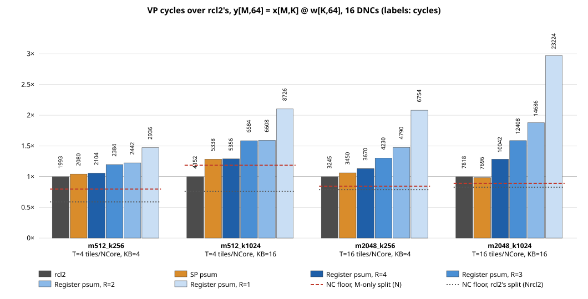
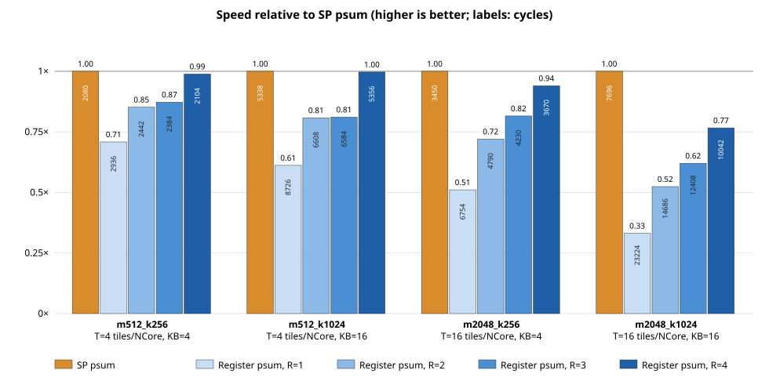
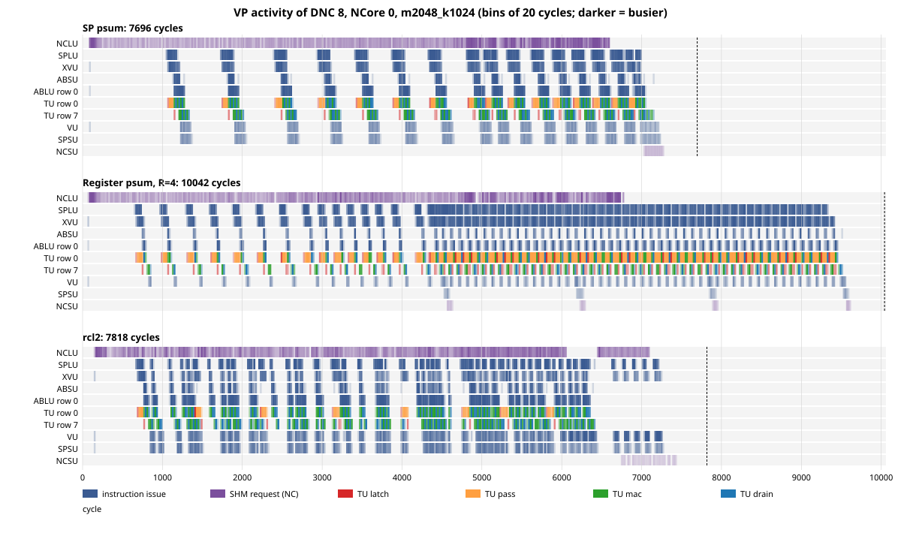

# K-outer matmul on the VP: VU-register accumulators (C) vs SP partial sums (A) vs rcl2

The two K-outer schedules of [`matmul-k-outer-schedule.md`](matmul-k-outer-schedule.md), written as assembly and
run on the VP over a small shape sweep, with rcl2's dense as the reference:

- **C, "register psum"**: R tiles' accumulators in VU registers (4R LRFs, R ≤ 4). R = 1 is mcc's order
  (M outside K).
- **A, "SP psum"**: every tile's partial sum in SP, read back by the SPLU and rewritten by the SPSU each K
  block. This is the order rcl2's dense uses.

Accumulation over K stays inside one DNC: the 16 DNCs split M only. The code, cases and scripts are in
[`matmul-kouter-vp/`](matmul-kouter-vp/).

## Setup

`y[M, 64] = x[M, K] @ w[K, 64]`, DLFloat16, R100 EVT1, VP `260521_vp_rebel_evt1_arbcal`.

| | |
|---|---|
| Split | DNC `d` takes `M/16` rows, each NCore half of them: `T = M/128` tiles of 4 rows per NCore; `KB = K/64` K blocks |
| Data | rcl2's dense test captured with `capture_rcl2.py` (manifest, SHM layout, rcl2's code); inputs from the manifest's seed |
| Code | written by [`scripts/gen_mm.py`](matmul-kouter-vp/scripts/gen_mm.py), every unit's program; assembled, closed with mcc's cluster fence (`xdnc_fence`), run with `run_vp.py` |
| Check | every run's output against `x @ w` in float64 from the same SHM inputs ([`scripts/check.py`](matmul-kouter-vp/scripts/check.py)) |
| NC floors | **N**: the NCLU loads and NCSU stores of A, with no compute. **Nrcl2**: the same for rcl2's split, read from rcl2's NCLU descriptors ([`scripts/gen_nc_rcl2.py`](matmul-kouter-vp/scripts/gen_nc_rcl2.py)) |

The NCLU loads in the order each schedule consumes (A: per K block; C: per group and K block) and signals both
SPLUs per chunk. A's SPSU signals the SPLU once per K block that the partial sums are written. mcc cannot build
these shapes (its SPSU block outgrows the 255-entry instruction buffer), so C with R = 1 stands in for mcc's
order. N = 256 is missing: rcl2's capture fails for it (`wrong scale dim`).

## Results

Cycles at which the VP stops, all DNCs returned. Every output matches `x @ w` (largest error over the largest
output, last two columns).

| Shape | T | KB | rcl2 | A | C, R=4 | R=3 | R=2 | R=1 | N | Nrcl2 | err rcl2 | err A, C |
|---|---|---|---|---|---|---|---|---|---|---|---|---|
| m512_k256 | 4 | 4 | 1993 | 2080 | 2104 | 2384 | 2442 | 2936 | 1590 | 1177 | 1.6e-3 | 1.7e-3 |
| m512_k1024 | 4 | 16 | 4152 | 5338 | 5356 | 6584 | 6608 | 8726 | 4923 | 3150 | 1.7e-3 | 3.3e-3 |
| m2048_k256 | 16 | 4 | 3245 | 3450 | 3670 | 4230 | 4790 | 6754 | 2735 | 2567 | 1.8e-3 | 1.5e-3 |
| m2048_k1024 | 16 | 16 | 7818 | **7696** | 10042 | 12408 | 14686 | 23224 | 6977 | 6462 | 1.3e-3 | 3.3e-3 |

Also in [`matmul-kouter-vp/results.tsv`](matmul-kouter-vp/results.tsv). Relative to rcl2:



The bars are cycles over rcl2's for each shape (labels: cycles). The dashed red line is the NC floor of this
experiment's split (N), the dotted line that of rcl2's split (Nrcl2). Drawn by
[`scripts/plot.py`](matmul-kouter-vp/scripts/plot.py).

- **SP psum** (variant A, the hand-tuned order rcl2 uses): the weights are latched once per K block, and every
  tile's partial sum round-trips through SP each K block. The SPSU must signal the SPLU before a partial sum
  is read back, the first K block is peeled (nothing to read yet) and the last one stores to the output instead
  of SP, and the SPLU sends x ahead of the partial sums so the pipeline does not stall.
- **Register psum, R** (variant C): the R tiles' partial sums stay in VU registers, so the only value carried
  across K blocks lives inside the VU. No unit waits on another across iterations and no K block is special,
  so the program is easier to write and check. The price is that the weights are latched once per group of R
  tiles, and the VU's 16 registers cap R at 4 (4 per tile).

## C against A: weight latches



Speed relative to SP psum (SP psum's cycles over each one's; higher is better), without rcl2; the labels in
the bars are cycles. With 4 tiles per NCore (T = 4) register psum reaches SP psum at R = 4; with T = 16 it
stays below, since R cannot exceed 4.

Each NCore latches `KB` weight tiles in A and `⌈T/R⌉ · KB` in C. A latch streams 64 w lines through
SPLU → XVU → TU north.

| T | A | C, R=4 | R=3 | R=2 | R=1 |
|---|---|---|---|---|---|
| 4 | KB | KB | 2 KB | 2 KB | 4 KB |
| 16 | KB | 4 KB | 6 KB | 8 KB | 16 KB |

- With `T = 4`, C with R = 4 latches as often as A and runs within 1.2% of it. R = 3 needs two groups (3 + 1),
  so it costs the same as R = 2.
- With `T = 16`, R = 4 still latches 4 times as often as A, and C falls behind: 30% at K = 1024.
- Each extra latch costs about 50–70 cycles where the compute is the bottleneck (m2048_k1024, m512_k1024),
  close to the 64 w lines at one line per cycle; less where the NC traffic hides it (m2048_k256).
- The VU's 16 LRFs cap R at 4, so C matches A only while `T ≤ 4` tiles per NCore (16 rows).

## Why rcl2 is faster than A

rcl2 splits the work differently. Read from its NCLU descriptors:

| Shape | DNCs used | K split across DNCs | Rows per DNC |
|---|---|---|---|
| m512_k256 | 12 | 2 | ~86 |
| m512_k1024 | 16 | 4 | 128 |
| m2048_k256 | 10 | none | ~205 |
| m2048_k1024 | 12 | 2 | ~342 |

So in three shapes rcl2 reduces partial sums across DNCs, which this experiment excludes, and it uses fewer
DNCs when K is short. Both cut the w lines read from SHM, since every DNC loads the w of its K range.

### rcl2's structure inside a DNC

rcl2 is weight-stationary and runs the order of variant A inside each DNC. Its units for m512_k1024, DNC 0
(64 rows per NCore, K blocks 0..3):

| Unit | Program |
|---|---|
| TU | `loop 4 (K block) { latch 64 w lines into LRF0..7; pass; loop 16 (tile) { mac; drain } }` |
| XVU | per K block: 64 w lines to the TU, then 64 x lines (all 16 tiles of the block) to the AB |
| ABSU, ABLU | the 16-block AB ring handed over in halves of 8 blocks |
| SPLU | per K block: the w lines, x as two 32-line bursts, then each tile's partial sum (2 + 4 lines) to the VU; one SPSU sync per K block |
| VU | first K block `FMAHP` (partial sums written as high and low parts, 6 SP lines per tile); later blocks `FADDHP` of the SP partial and the TU result; at the end the cross-DNC add (`FMA src0=FIFO_SPLU, src2=FIFO_XVU`) and scale and offset |

Weight latches and tiles per latch, per NCore:

| Shape | A (this experiment) | rcl2 |
|---|---|---|
| m512_k256 | 4 latches × 4 tiles | 2 × ~11 |
| m512_k1024 | 16 × 4 | 4 × 16 |
| m2048_k256 | 4 × 16 | 4 × ~26 |
| m2048_k1024 | 16 × 16 | 8 × ~43 |

### How rcl2 splits K and reduces

A group of `s` neighboring DNCs shares the same rows; DNC `j` of the group takes the contiguous K range
`j · K/s .. +K/s` (w and x of those K blocks only). In m512_k1024 (`s = 4`), DNCs 0..3 take K blocks 0..3,
4..7, 8..11, 12..15 of rows 0..127.

1. **Local K accumulation.** Each DNC runs the order of variant A over its K/s blocks: partial sums in SP, in
   high precision.
2. **Reduction tree.** After the matmul, a binary tree over the group, `log2 s` levels:

   ```
   s = 4:   level 1   DNC 1 → DNC 0     DNC 3 → DNC 2     (in parallel)
            level 2   DNC 2 → DNC 0
   s = 2:   level 1   DNC 1 → DNC 0
   ```

   The sender keeps its partial in its own SP. Its NCSU issues one `MESYNC` put+get to the receiver's NCLU:
   the put says the partial is ready, the get waits until the receiver has taken it. The receiver's NCLU waits
   for that put, loads the sender's partial straight from the sender's SP, and answers with a put. The load is
   an NC load whose address has no SHM tag: `CBR` = the sender's SP line and `CAR` = `0x8000 ×` (sender −
   receiver), 0x8000 lines being one DNC's SP. No partial goes through SHM. The receiver's SPLU streams the
   received partial and its own to the VU (one through the XVU), the VU adds them
   (`FMA src0=FIFO_SPLU, src2=FIFO_XVU`), and on the root applies scale and offset before the store.
3. **Store.** Only the group's root (`j = 0`) stores the rows to SHM.

### Why the K split pays despite the reduction

It is the weights. A K split of `s` cuts them twice:

1. **From SHM.** Each DNC loads only the w of its K range, so the 16 DNCs read w `16 / s` times instead of 16
   times. Most of the measured gap is this (next table and [The gap, split](#the-gap-split)).
2. **Into the TU.** Each DNC gets `s` times the rows, so one latched weight tile serves `s` times the tiles,
   and each NCore latches `1 / s` as often (previous table). A latch costs about 64 cycles.

The reduction costs much less than it saves: it moves only the partial rows, it never touches SHM, and it has
`log2 s` (one or two) levels.

Per 64 output columns, with `P` DNCs and the K split `s`, the lines the NC units move are

- w: `(P / s) · K`, since each of the `P / s` row groups reads all of w once;
- x: `M · K/64` and y: `M`, the same for any split;
- the reduction: `(s − 1) · M` partial lines, read DNC to DNC.

Splitting K trades the first term against the last. It pays while `P · K / s` falls faster than `(s − 1) · M`
grows; the total is smallest near `s = √(P · K / M)`. With `P = 16` that is 2.8, 5.7, 1.4 and 2.8 for the four
shapes, and rcl2 picks `s = 2, 4, 1, 2`: the split follows the w re-reads. For m2048_k256, where a split
does not pay, rcl2 instead leaves 6 DNCs idle, which also cuts the w copies (10 instead of 16).

| Shape | w + x + y lines, M-only split | rcl2's split: w + x + y | + partials | N / Nrcl2 |
|---|---|---|---|---|
| m512_k256 | 4096 + 2048 + 512 = 6656 | 1536 + 2048 + 512 = 4096 | 512 | 1.35 |
| m512_k1024 | 16384 + 8192 + 512 = 25088 | 4096 + 8192 + 512 = 12800 | 1536 | 1.56 |
| m2048_k256 | 4096 + 8192 + 2048 = 14336 | 2560 + 8192 + 2048 = 12800 | 0 | 1.07 |
| m2048_k1024 | 16384 + 32768 + 2048 = 51200 | 6144 + 32768 + 2048 = 40960 | 2048 | 1.08 |

The NC floors move with the traffic but less than in proportion (the floor is not pure bandwidth: each NCLU
issues its own loads, and the DNCs share the SHM bus). The reduction runs after the matmul, `log2 s` levels of
one load of the group's rows and one VU pass each; its cost is inside the rcl2 cycles above and was not
measured on its own.

### The gap, split

Splitting the gap into the NC floors and what each code adds above its floor:

| Shape | A − rcl2 | N − Nrcl2 (split) | A − N | rcl2 − Nrcl2 |
|---|---|---|---|---|
| m512_k256 | 87 | 413 | 490 | 816 |
| m512_k1024 | 1186 | 1773 | 415 | 1002 |
| m2048_k256 | 205 | 168 | 715 | 678 |
| m2048_k1024 | −122 | 515 | 719 | 1356 |

- The whole gap comes from the split. Both codes spend most of their time on NC traffic, and rcl2's split moves
  less of it (N − Nrcl2 ≥ A − rcl2 in every shape but one).
- Above its own floor, A adds less than rcl2 in three shapes, and 37 cycles more in m2048_k256, the one shape
  where both split only M. A's on-chip schedule is not what makes it slower.
- In m2048_k1024, where rcl2's K split saves least, A is 122 cycles faster than rcl2.

## TU utilization

The share of TU row-cycles that compute: over all 16 DNCs × 2 NCores × 8 TU rows, the cycles in which a row
issues a mac or drain beat. Latch and pass keep the TU busy too, but they move weights, so they are not
counted; the busy share (all four) is given below for m2048_k1024. One beat is a 4-term dot product on the row's 64 lanes, and a tile takes 8 beats
per K block, so a perfectly busy TU needs `M · K / 1024` cycles (the "ideal" column). Utilization is that over
the measured cycles; rcl2's idle DNCs count as idle.

| Shape | ideal cycles | rcl2 | SP psum | Register psum R=4 | R=3 | R=2 | R=1 |
|---|---|---|---|---|---|---|---|
| m512_k256 | 128 | 6% | 6% | 6% | 5% | 5% | 4% |
| m512_k1024 | 512 | 12% | 10% | 10% | 8% | 8% | 6% |
| m2048_k256 | 512 | 16% | 15% | 14% | 12% | 11% | 8% |
| m2048_k1024 | 2048 | 26% | 27% | 20% | 17% | 14% | 9% |

For m2048_k1024 the VP log confirms it: counting every TU row's issued FMAs, mac and drain fill 26.6% of the
row-cycles for SP psum, 20.4% for register psum (R = 4) and 26.4% for rcl2; latch and pass fill 7.5%, 22.9%
and 2.8%, so the TU is busy 34.1%, 43.3% and 29.2% of the time. The rest is idle, mostly waiting for the NC loads: with N = 64 every x line is used for one 64-column
block only, so these shapes move more data than they compute on, and the TU stays far from busy.

## Trace of the largest kernel

The VP's debug log (`verif_files/DebugLog__*.txt`) records every unit's instruction issue and every NC
request by cycle. [`scripts/trace.py`](matmul-kouter-vp/scripts/trace.py) bins them into a timeline. TU
issues are split by role from the FMA's operands: latch (weights into LRF0..7), pass (weights forwarded to the
rows below), mac and drain (a tile's two dot-product FMAs).

m2048_k1024, DNC 8, the last DNC to finish in all three runs (cluster 1, whose SHM loads finish about 2000
cycles after cluster 0's), NCore 0:



The same for DNC 0: [`trace_m2048_k1024_dnc0.svg`](matmul-kouter-vp/trace_m2048_k1024_dnc0.svg). The dashed
line is where the VP stops; the gap before it is the closing cluster fence waiting for the other DNCs.

- **SP psum** is load-bound. Each burst of compute is one K block, and it starts when the NCLU has loaded that
  block's w and x; between bursts the units idle. The TU spends little of a burst on latch and pass.
- **Register psum, R = 4** is load-bound for its first group only (that group loads all of w). After that the
  NCLU loads only x and finishes, and the compute runs alone for another ~3000 cycles. TU row 0 is then mostly
  orange: each re-latch makes row 0 issue 8 latch and 56 pass FMAs before its next tile, and the SPLU and XVU
  stream the 64 w lines meanwhile.
- **rcl2** loads until ~6000, then runs the cross-DNC reduction: DNC 8 loads its partner's partial
  (~6400–7100), the VU adds it, and the NCSU stores the rows.

### Why the weights cannot be double-buffered

The trace shows the latch as a block of row 0's issue slots, and the TU has no way to hide it:

- **Registers.** A TU row has 12 LRFs: 8 hold the weight tile and 4 the partial sums of the tile in flight.
  A second weight tile needs 8 more.
- **Issue slots.** A row issues one FMA at a time. Latching and passing the next tile's 64 lines are FMAs of
  the same row, so they take the slots the mac and drain of the current tiles need.
- **One way in.** Weights enter only through row 0's north link and move down one row per FMA, so row 0 forwards
  all 56 lines meant for the rows below.

The rows do overlap a little on their own, since row 7 still drains the last tiles while row 0 latches the
next weights. Beyond that, the only lever is to latch less often: more tiles per latch (SP psum, or a K split
that gives each DNC more rows).

## Beyond this sweep

These shapes have N = 64 and split M only, and their weights fit in SP. Real layers differ on all three, so
the numbers above do not carry over directly. The points below follow from the measurements and the SP size;
none of them was run.

### Is 26% utilization low?

For this shape, any chip would sit far from its compute peak. m2048_k1024_n64 does `2·M·K·N` = 268 MFLOP on
at least 4,587,520 bytes (x 4 MiB, w 128 KiB, y 256 KiB, DLFloat16), about 58.5 FLOP per byte. In general
the intensity is `M·K·N / (M·K + K·N + M·N)`, close to N when M and K are much larger than N: no reuse scheme
lifts it past 64 here. An H100 SXM (about 990 TFLOPS dense bf16,
3.35 TB/s HBM, public specs) needs about 300 FLOP per byte to be compute-bound, so from HBM this GEMM could
use at most about 20% of its compute; from L2 more, but a kernel this small is dominated by launch and tail
effects. GPUs and TPUs reach 70–80% and more on GEMMs large in all three dimensions. The fair measure here is
the distance from the NC floor: SP psum runs 1.10× its floor (N), rcl2 1.21× its own.

### Why N = 64 caps the utilization

The weights are reused well: one latched 64×64 tile serves all the DNC's rows. The activations are not: with
N = 64 each x line meets one weight tile and is dropped, so each line fetched from SHM feeds one tile's worth
of MACs. A TU row takes 8 cycles per tile (4 mac, 4 drain), so a busy NCore needs 4 x lines per 8 cycles, and
the 32 NCores 16 lines per cycle. The measured effective SHM throughput is about 7.3 lines per cycle, which
alone caps utilization near 45%; w and y traffic bring it down to the measured 26–27%. With a larger N the
same x line would meet N/64 weight tiles: kept in SP and re-streamed from there, it would cost SHM once.

The SHM is shared by the whole chip, but only through the 16 DNCs' NC units (NCLU, NCSU); the NCores read SP.
Cluster 1's loads finished about 2000 cycles after cluster 0's in the trace; the VP sets `shm_2mb_intrv`, and
where the data sits in the interleaved SHM may explain it (not checked).

### Real layer sizes

Here w is `K × 64` lines, at most 128 KiB. A real projection is far larger: Llama-2-7B's down_proj
(K = 11008, N = 4096, DLFloat16) is about 90 MB, against 4 MiB of SP per DNC and 64 MiB in all. So

- the weights are streamed through SP in tiles (the NCLU loads the next tile while the TU works on the current
  one: double buffering is possible at the SP, though not in the TU);
- the DNC split is chosen by which operand is larger: an M-only split, as here, copies w to every DNC; an N
  split copies x instead.

| | Decode (M = batch, small) | Prefill (M = thousands of tokens) |
|---|---|---|
| Traffic | w dominates (batch 8: x 176 KB, w 90 MB) | both large (M = 2048: x 45 MB, w 90 MB, y 16 MB) |
| Split | N (or K): each DNC reads only its own weights once | 2D, M × N, to balance the copies of x and w |
| Tiles per NCore | 1–2 | many |
| Schedule | register psum suffices (T ≤ 4) | SP psum: the K loop is tiled, see below |

Prefill's SHM traffic by split, 16 DNCs, down_proj at M = 2048:

| Split | x | w | Total |
|---|---|---|---|
| M only | 45 MB | 90 MB × 16 = 1.44 GB | ~1.5 GB |
| N only | 45 MB × 16 = 720 MB | 90 MB | ~810 MB |
| M 4 × N 4 | 45 MB × 4 = 180 MB | 90 MB × 4 = 360 MB | ~540 MB |

### Why prefill tiles x

With M 4 × N 4, one DNC's share is x 512 rows × 11008 (11.3 MB) and w 11008 × 1024 columns (22.5 MB): 2.7
and 5.4 times its SP. Streamed as in this sweep, re-reading x from SHM for every 64-column block, the DNC would
read its x 16 times (181 MB per DNC, about 2.9 GB for the chip). So both operands are cut into tiles that fit
SP, and each tile is reused while it is there:

```
for nt in N_d / Nt:                  // output column block
  for kt in K / Kt:                  // K block; partial sums stay in SP
    load x[0:Mt, kt], w[kt, nt]      // SHM -> SP (double-buffered)
    for each 64-column block of Nt:  //   latch a 64×64 weight tile in the TU
      for each 4-row tile of Mt:     //     stream the x tile through the AB
        psum[tile, cols] += x · w
  store y[0:Mt, nt]
```

The constraint is `Mt·Kt + Kt·Nt + Mt·Nt` (the last 1.5× in high precision) within SP, twice the first two for
double buffering; the DNC's traffic is then `x_d · N_d/Nt + w_d · M_d/Mt`. With Mt = 512, Nt = 256,
Kt = 512 the SP holds x 4096 + w 2048 + partial sums 2048 (3072 in high precision) lines, and x is read 4
times (45 MB) and w once (22.5 MB). Nt = 512 halves the x reads again.

Two consequences tie back to this sweep:

- With K tiled (Kt < K), the Mt × Nt partial sums live across K blocks, far beyond the VU's 16 registers. In
  prefill SP psum is the structure, not an option.
- The TU's weight latch is amortized over Mt / 4 tiles, so large Mt matters as in the measurements above.

By the effective SHM rate measured here (about 7.3 lines, 930 B per cycle), 540 MB takes about 580k cycles
against 1.4M cycles of compute at the TU's peak (92 G MACs over 65536 MACs per cycle): prefill at this size
could be compute-bound, where the TU's latch and pass overhead counts again.

## Other findings

- **Precision.** A and C accumulate in DLFloat16 (VU registers or SP lines); rcl2 accumulates in high precision
  (`FMAHP`, 6 SP lines per tile on EVT1 instead of 4). At K = 1024 A's error is twice rcl2's. A with rcl2's
  high-precision partial sums would move 50% more SP lines per tile.
- **AB handshake.** A first version released the AB one block at a time, with `L` blocks of credit
  (`L = min(8, T)`). Register psum hung on the VP for every R at T = 16 (125000-cycle limit), though its
  counts balance; SP psum did not. With a 6000-cycle limit on m2048_k256, R = 4 hung with L = 1, 7 and 8 and
  finished with L = 2..5 ([Artifacts](#artifacts)). The version measured here uses mcc's and rcl2's handshake:
  the ABSU writes 8 blocks, then waits until the ABLUs have released the half of the 16-block ring it is about
  to overwrite. The hang is not explained.

## Limits

- One output block (N = 64); a larger N repeats the same nest per 64 columns.
- Nrcl2 approximates rcl2's cross-DNC reduction traffic (one partial per partner, loaded by the root).
- A signals once per K block; finer signals would let the SPLU read a tile's partial sums earlier.
- VP cycles only; the VP has no per-unit statistics, so the overheads above the NC floor are not split further.

## Artifacts

Everything a run used or produced is kept in [`matmul-kouter-vp/`](matmul-kouter-vp/) (26 MB), so each number
above can be traced to the code that ran.

| Item | Value |
|---|---|
| Date | 2026-10-22 and 23 |
| codesigner | `082b42cfa` (branch `dnc-binutils-legacy-dir`): `run_vp.py`, `capture_rcl2.py`, `dnc_binutils`, mcc's `xdnc_fence` |
| rcl2 | `5e1413153067` (the capture's `manifest.json`), dense test `test_rbln_initgen_dense_fp16.py` |
| VP | `260521_vp_rebel_evt1_arbcal`, 2 clusters × 8 DNCs, 125000-cycle limit |
| Inputs | random DLFloat16 from the manifest's seed (0), regenerated by `run_vp.py` on every run |

The assembly, one directory per run, each with `raw_<d>.s` as generated and `init_<d>.s` as run (closed with
the cluster fence) for all 16 DNCs:

| Directory | Generator | Runs |
|---|---|---|
| `asm/<shape>.A`, `asm/<shape>.C1` .. `C4` | `scripts/gen_mm.py` (half-ring AB handshake) | the results above |
| `asm/<shape>.N` | `scripts/gen_nc.py --variant N` | NC floor, this experiment's split |
| `asm/<shape>.Nrcl2` | `scripts/gen_nc_rcl2.py` | NC floor, rcl2's split |
| `cases/dense/<shape>/base/code/` | rcl2 (captured) | rcl2 |
| `asm/per-block-handshake/<shape>.<A, C1..C4>` | `scripts/gen_mm_per_block.py` (per-block AB credit, `L = min(8, T)`) | the first sweep, below |
| `asm/per-block-handshake/lead/m2048_k256_n64.C<R>L<L>` | `scripts/gen_mm_per_block.py --R R --lead L` | the credit experiment, below |
| `asm/per-k-block-sync/<shape>.C<R>` | `scripts/gen_mm_per_k_block_sync.py` | AB synced once per K block, below |

The first sweep, with the per-block handshake (cycles; "hang": the VP stopped at its 125000-cycle limit):

| Shape | A | C1 | C2 | C3 | C4 |
|---|---|---|---|---|---|
| m512_k256 | 2080 | 2936 | 2450 | 2386 | 2110 |
| m512_k1024 | 5372 | 8726 | 6666 | 6610 | 5374 |
| m2048_k256 | 3496 | hang | hang | hang | hang |
| m2048_k1024 | 7818 | hang | hang | hang | hang |

The credit experiment on m2048_k256, with the VP limit lowered to 6000 cycles (`timeout_cycles` in a copy of
the case's manifest): C4 with L = 1, 7, 8 hung; L = 2, 3, 4, 5 took 4410, 4274, 3702, 3702; C2 with L = 2
and 4 took 4834. C1 with L = 4 did not finish in 6000 cycles, which says nothing about a hang: C1 needs
6754 cycles even with the half-ring handshake.

The VP debug logs behind the traces (150–200 MB per run) are not kept; `scripts/run.sh` regenerates them
in the run's work directory, and `scripts/trace.py` reads them from there.

Syncing the AB once per K block instead, inside the existing loops (the rule in `mlir-machine-ir.md`), was
checked on register psum: m512_k256 and m2048_k256 with R = 4 (4 blocks per sync) and R = 2 (2 blocks) took
2104, 3670, 2442 and 4790 cycles, the same as the half-ring runs, with the same outputs
(`asm/per-k-block-sync/`, `scripts/gen_mm_per_k_block_sync.py`).

The scratch runs named the half-ring runs `h1` .. `h4` and `hA`; they are `C1` .. `C4` and `A` here.

## Files

[`matmul-kouter-vp/`](matmul-kouter-vp/):

| Path | Contents |
|---|---|
| `asm/<shape>.<A, C1..C4, N, Nrcl2>/` | `raw_<d>.s` as generated, `init_<d>.s` as run (fence added), per DNC |
| `cases/dense/<shape>/` | rcl2's capture: `base/manifest.json`, `base/data/`, `base/code/` (rcl2's code), and `kernel.py` |
| `scripts/gen_mm.py` | A and C |
| `scripts/gen_mm_per_block.py` | A and C with the per-block AB handshake (first sweep; hangs at T = 16) |
| `scripts/gen_nc.py`, `scripts/gen_nc_rcl2.py` | the NC floors N and Nrcl2 |
| `scripts/finish.py`, `scripts/run.sh`, `scripts/check.py` | assemble and fence, run one case, check the output |
| `scripts/capture_more.py` | `capture_rcl2.py` with extra dense shapes |
| `scripts/plot.py`, `cycles.svg`, `speed.svg` | the two charts, drawn from `results.tsv` |
| `scripts/trace.py`, `trace_m2048_k1024_dnc0.svg`, `trace_m2048_k1024_dnc8.svg` | the unit timelines, drawn from the VP debug logs |

`scripts/run.sh m2048_k256_n64 C 4` regenerates and reruns one point; an M = 2048 run takes 10–60 minutes of
wall time on the VP.
